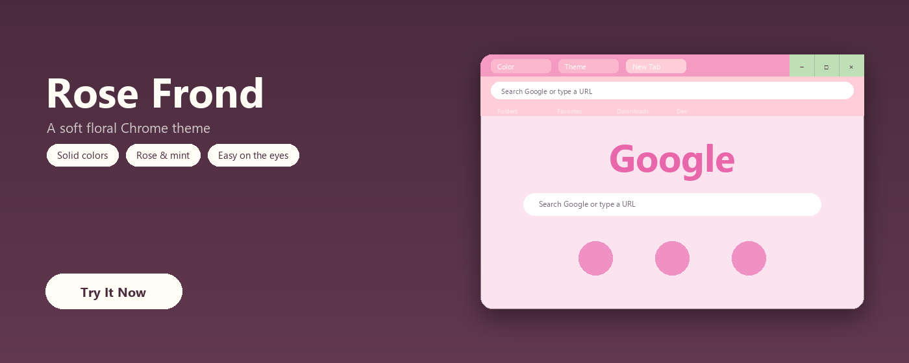
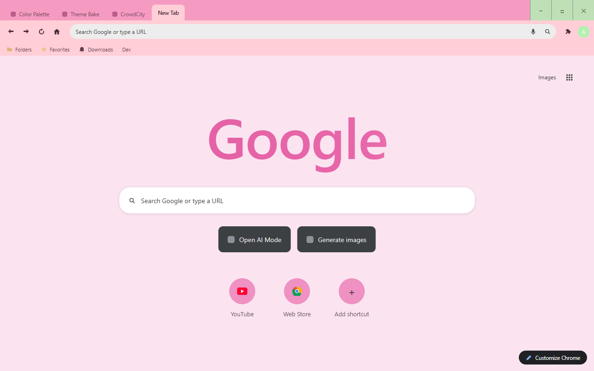
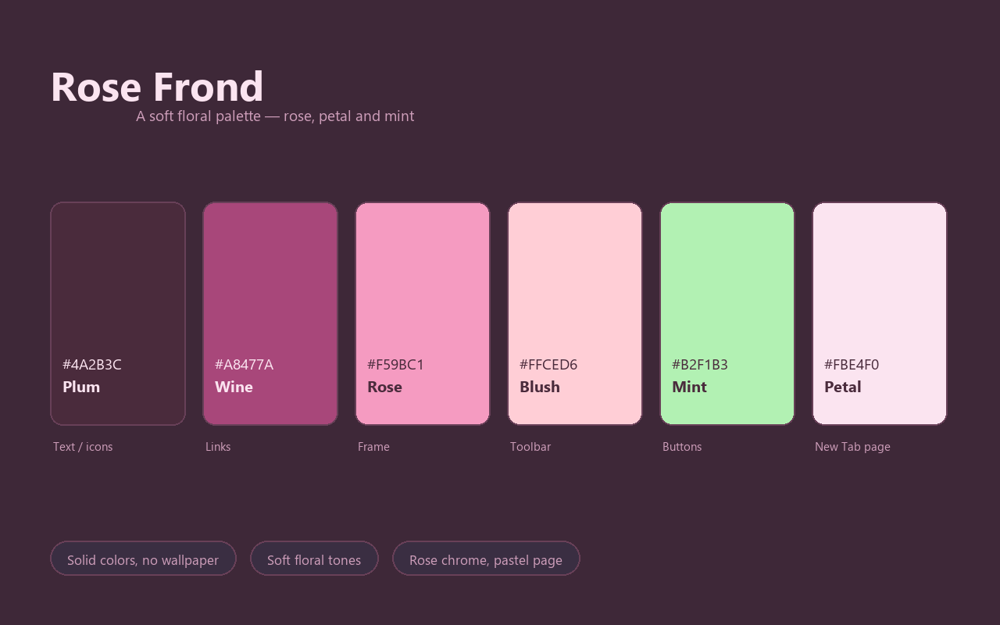

<p align="center">
  
</p>

<h1 align="center">Rose Frond Theme</h1>

<p align="center">
  A soft floral Chrome theme: rose chrome, a blush toolbar and a petal-white New Tab Page.
</p>

<p align="center">
  
  
  
  
</p>

<p align="center">
  
</p>

## Overview

Rose Frond is a flower bed in soft focus: a rose strip, a blush toolbar, and a pastel-pink New Tab Page where Chrome paints its mark in rose-magenta. Deep plum ink keeps every tab, bookmark and toolbar icon readable on the light chrome, and mint stays on the buttons as the single cool note.

## Design Concept

Two things make this pale palette usable:

1. **Pick the widest three depths** — rose `#F59BC1` frame, blush `#FFCED6` toolbar, petal `#FBE4F0` page. The page leans violet-pink on purpose: a warm near-white made Chrome derive a coral logo, while this pastel pink yields the rose mark you see in the screenshots.
2. **Bring one ink from outside the palette** — deep plum `#4A2B3C` (≈11:1 on the page), with a deeper rose for links (≈5.2:1). Mint `#B2F1B3` only appears on buttons.

| Color | Hex | RGB | Role |
|---|---|---|---|
| Plum | `#4A2B3C` | 74, 43, 60 | Text / icons |
| Wine | `#A8477A` | 168, 71, 122 | New Tab links |
| Rose | `#F59BC1` | 245, 155, 193 | Frame |
| Blush | `#FFCED6` | 255, 206, 214 | Toolbar |
| Mint | `#B2F1B3` | 178, 241, 179 | Buttons |
| Petal | `#FBE4F0` | 251, 228, 240 | New Tab background |

## Features

- Pure color, no wallpaper — fast and distraction-free
- Soft floral palette: rose, blush, pastel pink and a single mint accent
- Light chrome with deep plum ink — ≈11:1 contrast
- Tab text, bookmark text and toolbar icons all share the same plum ink
- Single-row shortcut row and a colour-matched mark for a clean New Tab Page
- No configuration needed — install and enjoy

## Screenshots

| Browser | Palette |
|:-:|:-:|
|  |  |

## Installation

### Load unpacked (development)

1. Download or clone this repository.
2. Open `chrome://extensions` in Chrome.
3. Enable **Developer mode** in the top right.
4. Click **Load unpacked** and select this folder (`rose-frond-theme`).
5. The theme is active immediately.

### Package for the Chrome Web Store

```
chrome://extensions → Pack extension → select this folder → rose-frond-theme.zip
```

Upload the resulting `.zip` to the [Chrome Web Store developer dashboard](https://chrome.google.com/webstore/devconsole).

## Store listing copy

Ready to paste into the store listing (also kept in `store-assets/store-description.txt`):

> Rose Frond is a soft floral Chrome theme: a rose frame, a blush toolbar and a petal-white New Tab Page. Deep plum ink keeps every tab, bookmark and toolbar icon readable on the light chrome, with mint accents and a leaf-fan icon. Solid colors only, no wallpaper.

## Project structure

| File | Purpose |
|---|---|
| `manifest.json` | Theme definition (single-file, inlined `theme` field) |
| `logo/logo.png` | 128×128 store icon (transparent background) |
| `store-assets/promo/440x280.png` | Small promo tile |
| `store-assets/promo/1400x560.png` | Marquee promo tile |
| `store-assets/screenshots/en/screenshot-1-browser.png` | Browser mockup screenshot (1280×800) |
| `store-assets/screenshots/en/screenshot-2-palette.png` | Palette introduction screenshot (1280×800) |
| `store-assets/store-description.txt` | Store listing description |
| `scripts/generate-logo-vector.py` | Render all SVG logo candidates with headless Chromium, export `logo/logo.png` from `SELECTED` |
| `scripts/generate-screenshot-headless.py` | Regenerate the browser mockup via Playwright |
| `scripts/generate-screenshot-2-palette.py` | Regenerate the palette screenshot |
| `scripts/generate-promo.py` | Regenerate both promo tiles (1400×560 window hero, 440×280 dot palette) |
| `LICENSE` | Non-Commercial License (English / 中文) |

## Regenerating assets

Every asset is code-generated, so nothing here is hand-drawn or hand-copied:

```bash
py -3 scripts/generate-logo-vector.py         # candidates + logo/logo.png
py -3 scripts/generate-screenshot-headless.py # store screenshot 1 (browser mockup)
py -3 scripts/generate-screenshot-2-palette.py # store screenshot 2 (palette)
py -3 scripts/generate-promo.py               # promo 440x280 + 1400x560
```

To ship a different icon candidate, change `SELECTED` at the top of `generate-logo-vector.py` and re-run, then re-run the three asset scripts so the promo and screenshots pick up the new logo.

## License

Rose Frond Theme is released under the Non-Commercial License. See `LICENSE` for full text (English / 中文).
